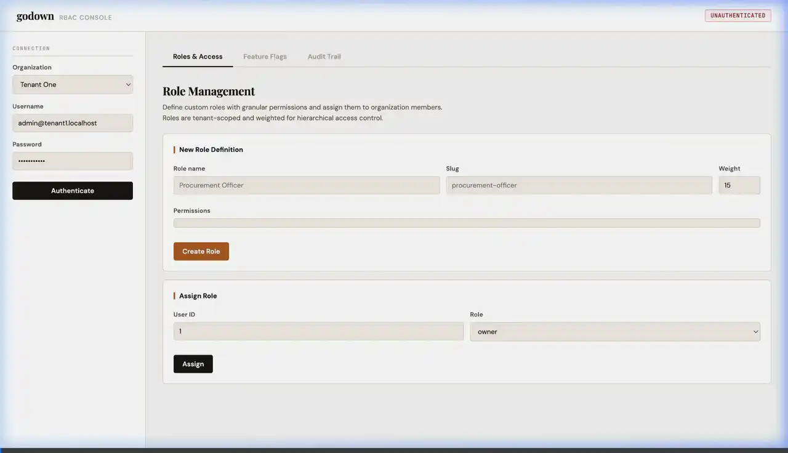
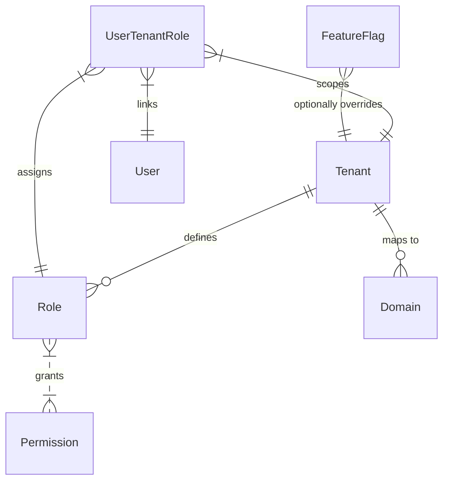
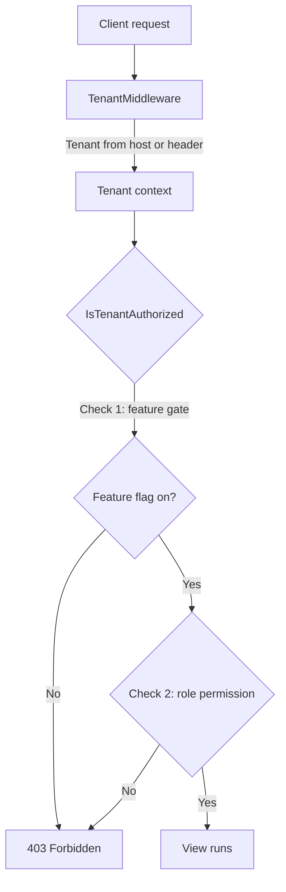
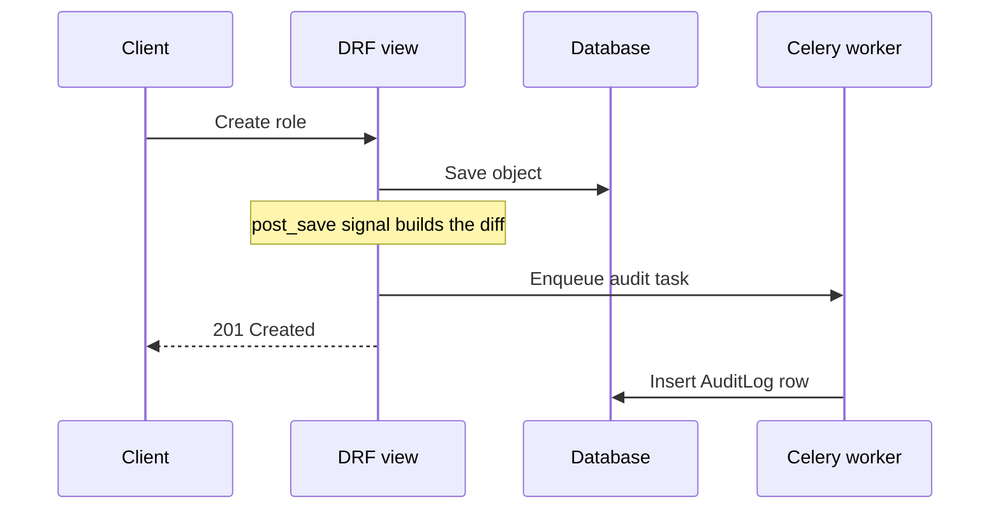

# godown: multi-tenant RBAC and feature flags for Django REST Framework

[](https://github.com/areycruzer/godown-rbac-system/actions/workflows/ci.yml)

A Django and Django REST Framework backend with three parts:

- **Multi-tenancy.** Each request is resolved to an organization (tenant) from the subdomain or an `X-Tenant-ID` header.
- **Dynamic role-based access control.** Tenant admins create their own roles, attach permissions to them, and assign them to members.
- **Feature flags and audit logs.** Features can be switched on or off globally or per tenant, and changes are recorded with a before and after diff.

Business rules live in a service layer (`services/`), separate from the DRF views in `apps/`. The test suite has 268 tests and runs in CI against PostgreSQL 17.



## How it works

### Data model

Tenants share one database. Roles, role assignments and feature flag overrides all carry a tenant, so every check is scoped to the current organization.



### Request path

`TenantMiddleware` resolves the tenant. The `IsTenantAuthorized` permission class then checks the feature flag first and the role permission second.



### Audit log

Model changes fire Django signals that capture the state before and after the change. The diff is written to the audit log by a Celery task, so the request does not wait for it.



## Features

- **Tenants.** Creating a tenant seeds default `owner`, `admin` and `member` roles with their permissions.
- **Permissions.** Permissions are registered globally as codes such as `po:create`, `grn:create` and `audit:view`.
- **Custom roles.** Tenant admins can define roles such as "Procurement Officer" and bind any set of permissions to them.
- **Role weights.** Each role has a numeric weight, so code can check whether a user is at least an admin.
- **Feature flags.** Flags have a global default and an optional per-tenant override. One permission class checks both the flag and the role.
- **Audit trail.** Logins, failed logins, role changes and permission changes are recorded, with field-level before and after values stored as JSON.

## Project layout

```
godown-rbac-system/
├── apps/
│   ├── audit/            # signals, audit middleware, Celery logging task
│   ├── authentication/   # JWT login, registration
│   ├── common/           # health checks, error format, shared permissions
│   ├── notifications/    # notification hooks
│   ├── rbac/             # permission registry, roles, assignments
│   ├── tenants/          # tenant resolution, feature flags
│   └── users/            # user profiles
├── services/             # business logic used by the views
│   ├── rbac/
│   ├── features/
│   ├── audit/
│   └── demo/             # demo data seeder
├── tests/                # unit, service and integration tests
└── examples/frontend/    # Next.js helpers: auth context and a <Guard> component
```

## Run it locally

```bash
python3.12 -m venv .venv
source .venv/bin/activate
pip install -r requirements.txt
cp .env.example .env
python manage.py migrate
python manage.py seed_demo
python manage.py runserver
```

`seed_demo` creates two tenants, `tenant1` and `tenant2`, and an admin account for local use only:

- Username: `admin@tenant1.localhost`
- Password: `password123`

The admin console is at `http://localhost:8000/` and the Swagger docs are at `http://localhost:8000/api/docs/`.

## Run the tests

The tests run offline on SQLite with an in-memory cache, so no Postgres or Redis server is needed. Settings read three environment variables at import time; these dummy values are enough:

```bash
export SECRET_KEY=test-secret-key-for-testing-only
export DATABASE_URL=sqlite:////tmp/godown-test.sqlite3
export REDIS_URL=redis://localhost:6379/0
pytest -q
```

If `DATABASE_URL` starts with `postgres`, the tests use that database instead. CI runs them against PostgreSQL 17 (see `.github/workflows/ci.yml`).

## Frontend example

`examples/frontend/` has a React `<Guard>` component that shows its children only when the user has the permission and the feature is on:

```tsx
import { Guard } from '@/components/Guard';

export default function ActionButton() {
  return (
    <Guard permission="po:create" feature="procurement_v2_enabled">
      <button className="btn-primary">Create Purchase Order</button>
    </Guard>
  );
}
```

See the [frontend guide](examples/frontend/README.md) for the hooks and auth context.

## License

MIT
